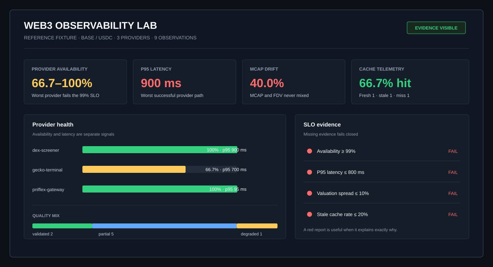
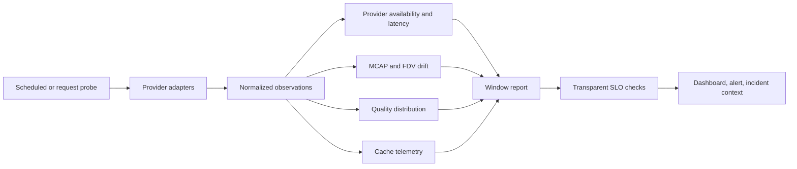

<div align="center">

# Web3 Observability Lab

### Provider health, latency, valuation drift, data quality, and cache evidence in one inspectable report.

   [](https://github.com/0xENTYPER/web3-observability-lab/actions/workflows/ci.yml)

</div>



> The visual above is generated from the checked-in deterministic reference fixture. It is not a production screenshot and does not claim live operational results.

Web3 products often monitor whether an HTTP request returned while missing the failures that actually reach users: one provider timing out, a second returning a different market cap, a cache serving stale data too often, or a response being technically available but only partially verified.

This repository turns those conditions into explicit, testable product signals. It contains a small TypeScript metrics library, a live gateway probe, a CLI report, deterministic observations, SLO evaluation, and tests for the boundaries where dashboards commonly become misleading.

## What it answers

| Question | Signal | Product consequence |
| --- | --- | --- |
| Is each provider reachable? | Successes / all probes | Select fallback behavior and incident severity |
| How slow is the worst normal path? | Provider p50 and p95 | Protect interaction budgets instead of averaging pain away |
| Do providers agree on valuation? | MCAP and FDV spread, calculated separately | Prevent a plausible but incorrect headline number |
| How trustworthy are successful responses? | Validated / partial / degraded distribution | Keep quality visible after transport succeeds |
| Is the cache helping or hiding age? | Fresh, stale, miss, hit rate, stale rate | Tune resilience without silently serving old truth |

## Quick start

```bash
npm install
npm run check
npm test
npm run report
```

Probe the deployed PNLFlex gateway with a real token:

```bash
npm run probe -- \
  https://gateway-demo.pnlflex.xyz \
  base \
  0x833589fCD6eDb6E08f4c7C32D4f71b54bdA02913
```

The probe emits one normalized observation. Store repeated observations in any event sink, then feed a time window into `buildReport()`.

## Observation contract

```ts
interface Observation {
  batchId: string;
  observedAt: string;
  provider: string;
  chain: string;
  asset: string;
  status: "ok" | "error" | "timeout";
  latencyMs: number | null;
  marketCapUsd: number | null;
  fdvUsd: number | null;
  independentValuation?: boolean;
  quality: "validated" | "partial" | "degraded" | "unknown";
  cache: "fresh" | "stale" | "miss" | "none";
  errorCode?: string;
}
```

`batchId` groups observations captured for the same asset and sampling moment. Drift is calculated only inside that comparable group. `independentValuation: false` marks an aggregator whose value is derived from already observed upstream evidence, preventing that value from receiving a second vote in the median.

## Architecture



The library owns aggregation semantics. A scheduler owns sampling frequency, storage owns retention, and an alerting system owns notification delivery. Keeping those responsibilities separate makes the metric logic runnable without Cloudflare, a database, or a specific dashboard vendor.

## Metric semantics

### Provider availability

```text
availability = successful probes / all probes
```

Timeouts and HTTP failures remain in the denominator. A provider with one fast success and nine timeouts must not look healthy because latency was computed only from the success.

### Latency

Latency percentiles use successful probes only, while availability reports the missing requests. The report keeps p50 and p95 per provider instead of mixing a direct provider call with a cached gateway response.

### Valuation drift

```text
spread % = (maximum - minimum) / median * 100
```

The comparison key is `batchId + chain + asset + valuation kind`. MCAP is compared only with MCAP; FDV only with FDV. Missing values reduce evidence instead of being replaced with zero or copied from the other field. Correlated aggregator values stay observable but are excluded from cross-provider drift.

| Spread | Severity |
| ---: | --- |
| `< 5%` | normal |
| `5–20%` | warning |
| `≥ 20%` | critical |

### Cache behavior

```text
hit rate   = (fresh + stale) / cache-aware requests
stale rate = stale / cache-aware requests
```

`none` means the provider does not expose cache state and is excluded from the cache denominator. A high hit rate is not automatically healthy if most hits are stale, which is why both metrics are shown.

### Quality distribution

Only successful responses participate in data-quality counts. Transport failure and unknown quality are different problems and should not be merged into one percentage.

## SLO policy

The defaults are intentionally readable and configurable:

```ts
const DEFAULT_SLO = {
  minimumAvailability: 0.99,
  maximumP95LatencyMs: 800,
  maximumValuationSpreadPercent: 10,
  maximumStaleRate: 0.2
};
```

Missing evidence fails closed. A dashboard should say that a metric cannot be proven rather than showing a green state from an empty sample.

## Example report

`npm run report` reads [`fixtures/observations.json`](fixtures/observations.json). The fixture deliberately contains a timeout, a slow response, a critical MCAP disagreement, and stale cache usage so the resulting report demonstrates failure states rather than a decorative all-green dashboard.

```json
{
  "providers": [
    {
      "provider": "gecko-terminal",
      "availability": 0.6666666666666666,
      "p95LatencyMs": 700,
      "errors": { "upstream_timeout": 1 }
    }
  ],
  "cache": {
    "hitRate": 0.6666666666666666,
    "staleRate": 0.3333333333333333
  },
  "valuationDrift": [
    {
      "kind": "market-cap",
      "spreadPercent": 40,
      "severity": "critical"
    }
  ]
}
```

## UI rationale

- **Start with decisions, not charts:** availability, latency, drift, and cache state appear as separate top-level signals because each has a different owner and remediation.
- **Show the worst provider path:** averages can hide the provider that makes a fallback chain unreliable.
- **Keep red useful:** each failed SLO includes actual value, target, operator, and source metric.
- **Label fixture visuals:** portfolio material must distinguish reproducible examples from live production evidence.
- **Avoid composite health scores:** a single 82/100 score would hide whether the problem is latency, evidence disagreement, or stale data.

## Repository map

| Path | Responsibility |
| --- | --- |
| [`src/model.ts`](src/model.ts) | Observation, report, drift, cache, and SLO contracts |
| [`src/metrics.ts`](src/metrics.ts) | Deterministic metric calculations and thresholds |
| [`src/report.ts`](src/report.ts) | Window report composition |
| [`src/probe.ts`](src/probe.ts) | Live PNLFlex gateway observation adapter |
| [`src/cli.ts`](src/cli.ts) | JSON fixture or exported-window reporting |
| [`fixtures/observations.json`](fixtures/observations.json) | Explicit deterministic failure scenarios |
| [`test`](test) | Metric boundaries, drift semantics, SLOs, and probe behavior |

## Production extension points

The reference keeps infrastructure replaceable. A production system can add:

- Cron Triggers or an external scheduler for sampling;
- Analytics Engine, ClickHouse, TimescaleDB, or another event store;
- per-chain and per-asset cardinality controls;
- rolling windows and burn-rate alerts;
- incident links carrying request IDs and provider evidence;
- alert routing to Telegram, Slack, PagerDuty, or email;
- sampling budgets and provider-specific rate-limit policies.

## Verification

```bash
npm run check
npm test
npm run build
npm run report
```

Tests protect percentile behavior, error denominators, cache semantics, quality filtering, MCAP/FDV separation, drift severity, missing-evidence handling, report composition, and live-probe normalization.

## Scope and privacy

This is a public reference implementation. It contains no private provider keys, production alert destinations, customer telemetry, proprietary thresholds, or incident history. The fixture is synthetic and explicitly labelled.

## Related work

- [cloudflare-web3-api-gateway](https://github.com/0xENTYPER/cloudflare-web3-api-gateway) exposes the live evidence consumed by the included probe.
- [onchain-market-data-pipeline](https://github.com/0xENTYPER/onchain-market-data-pipeline) explains provider normalization and cache behavior.
- [multi-chain-token-resolver](https://github.com/0xENTYPER/multi-chain-token-resolver) goes deeper into token identity, pair scoring, and capitalization semantics.
- [web3-product-architecture](https://github.com/0xENTYPER/web3-product-architecture) documents the product boundaries around evidence and observability.

---

Built by [0xENTYPER](https://github.com/0xENTYPER).
